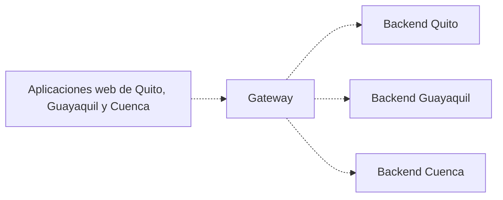

<div align="center">

# 🏥 Hospital Distribuido

**Tres sedes hospitalarias en un mismo proyecto**  
Quito · Guayaquil · Cuenca


[Ver arquitectura](#arquitectura) · [Explorar las sedes](#sedes) · [Probar los frontends](#inicio-rápido)

</div>

## El proyecto

Hospital Distribuido plantea una arquitectura para tres sedes hospitalarias. Cada ciudad tiene su propia aplicación web y un paquete de backend. La estructura reserva un gateway como punto común de entrada a los servicios de las sedes.

## Arquitectura

El diagrama muestra la arquitectura prevista. En la versión actual, los frontends contienen pantallas de inicio y los cuatro paquetes de backend están inicializados con sus manifiestos de npm.



## Sedes

| Sede | Tecnología | Aplicación web | Backend |
| :--- | :--- | :--- | :--- |
| Quito | Vue 3 · Vite | [Frontend Quito](frontend/frontend-quito/) | [Backend Quito](backend/backend-quito/) |
| Guayaquil | Next.js · React | [Frontend Guayaquil](frontend/frontend-guayaquil/) | [Backend Guayaquil](backend/backend-guayaquil/) |
| Cuenca | Next.js · React | [Frontend Cuenca](frontend/frontend-cuenca/) | [Backend Cuenca](backend/backend-cuenca/) |

El repositorio también incluye el [paquete del gateway](backend/backend-gateway/) y la [carpeta de importación de datos](import/), con archivos vacíos reservados para la estructura y la carga de datos.

## Inicio rápido

Usa **Node.js 22.12 o superior** y **npm**. Desde la raíz del repositorio, despliega la sección de la sede que quieras probar.

<details>
<summary><strong>Quito · Vue 3 y Vite</strong></summary>

```bash
cd frontend/frontend-quito
npm install
npm run dev
```

Abre <http://localhost:5173> o consulta la dirección que indica Vite en la terminal.

</details>

<details>
<summary><strong>Guayaquil · Next.js</strong></summary>

```bash
cd frontend/frontend-guayaquil
npm ci
npm run dev -- --port 3001
```

Abre <http://localhost:3001>.

</details>

<details>
<summary><strong>Cuenca · Next.js</strong></summary>

```bash
cd frontend/frontend-cuenca
npm ci
npm run dev -- --port 3002
```

Abre <http://localhost:3002>.

</details>

Los puertos de esta guía permiten abrir las tres aplicaciones al mismo tiempo. Ejecuta cada bloque en su propia terminal.
